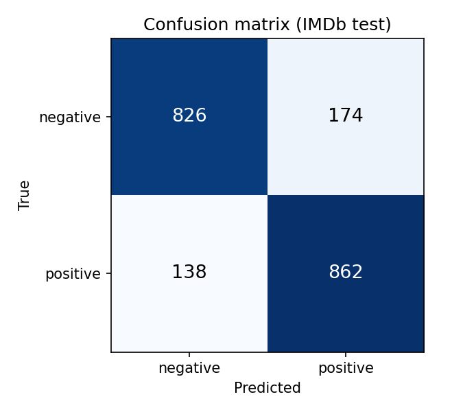
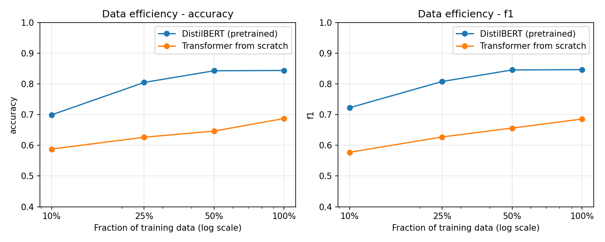
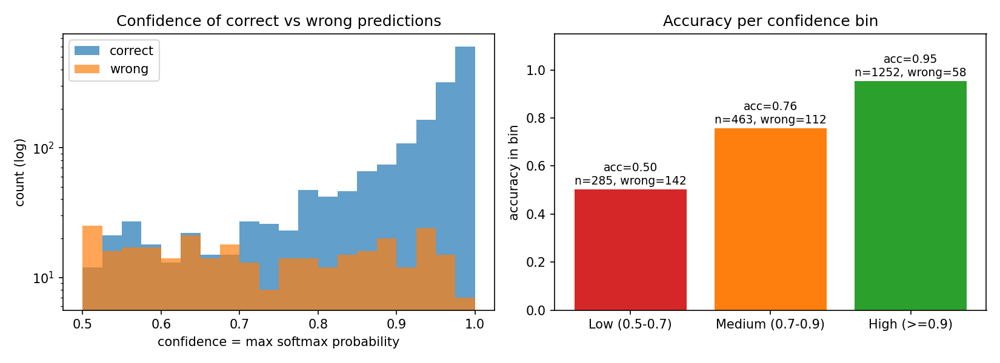

# LAB 08 — Pretrained Transformers and BERT Fine-Tuning

---

## 1. Tổng quan Lab

Trong các bài thực hành trước, chúng ta đã đi từ cơ chế Attention đến một Transformer hoàn chỉnh:
- **LAB 06 (Attention & Self-Attention):** Thay trạng thái nén $\vec{h}_T$ của RNN bằng Context Vector $\vec{c} = \sum_i \alpha_i \vec{v}_i$, cho phép mọi cặp token tương tác trực tiếp với chi phí $\mathcal{O}(T^2)$.
- **LAB 07 (Transformer from scratch):** Lắp ráp Multi-Head Attention, Positional Encoding, Feed-Forward, Residual + LayerNorm thành Transformer Encoder và huấn luyện từ trọng số ngẫu nhiên:
  $$D_{\text{task}} \to \text{Transformer} \to \text{task loss}$$

Một Transformer huấn luyện từ đầu phải học đồng thời **biểu diễn ngôn ngữ** và **nhiệm vụ phân loại** chỉ từ dữ liệu của chính bài toán. Khi dữ liệu downstream nhỏ, đây là điểm nghẽn lớn.

Trong **LAB 08**, chúng ta chuyển sang mô hình **Pretraining → Fine-tuning**. Một Transformer được huấn luyện trước trên kho văn bản lớn bằng Masked Language Modeling:
$$L_{\text{MLM}} = -\sum_{i \in M} \log P(y_i \mid x)$$
sau đó được tiếp tục huấn luyện trên tập dữ liệu cụ thể:
$$\theta_{\text{pretrained}} \to \theta_{\text{task}}$$
Biểu diễn `[CLS]` của encoder pretrained được đưa qua một classification head tuyến tính (thành phần task-specific) để phân loại cảm xúc IMDb.

Quy trình nghiên cứu và thực nghiệm trong Lab 08 gồm:
> Tính tay MLM loss và phân tích tokenization → Thiết lập 3 dự đoán trước thí nghiệm → Khảo sát tokenizer, subword, special tokens và attention mask → Cài đặt pretrained encoder + classification head trên `[CLS]` → Exp 1: Pretrained vs Transformer from scratch → Exp 2: Frozen encoder (feature extraction) vs Fine-tuning → Exp 3: Data efficiency 10% / 25% / 50% / 100% → Exp 4: Max sequence length 64 / 128 / 256 → Exp 5: Domain shift IMDb → Tweets → Đánh giá Accuracy / Precision / Recall / F1 + Confusion Matrix → Confidence analysis → Error analysis → Reflection và cầu nối sang LAB 09 (Token Classification / NER).

---

## 2. Mục tiêu học tập cốt lõi (Learning Outcomes)

1. **LO1 — Pretraining vs Fine-tuning:** Phân biệt giai đoạn học biểu diễn ngôn ngữ trên kho văn bản lớn và giai đoạn thích nghi với nhiệm vụ cụ thể; fine-tuning không bắt đầu từ trọng số ngẫu nhiên.
2. **LO2 — Masked Language Modeling:** Mô tả ý tưởng dự đoán token bị che $P(w_t \mid w_{\neq t})$ và tính cross-entropy loss trên tập vị trí bị mask.
3. **LO3 — Tokenizer & Subword:** Giải thích luồng raw text → tokenizer → token IDs → embedding → Transformer, và cách subword token xử lý từ hiếm / từ chưa gặp.
4. **LO4 — Special Tokens & Attention Mask:** Nhận diện vai trò của `[CLS]`, `[SEP]`, `[PAD]`, `[MASK]`, `[UNK]` và cách attention mask loại padding khỏi tính toán.
5. **LO5 — [CLS] Classification:** Sử dụng biểu diễn `[CLS]` làm đại diện chuỗi cho classification head tuyến tính.
6. **LO6 — Training Regimes:** Phân biệt training from scratch, feature extraction (frozen encoder) và full fine-tuning.
7. **LO7 — Controlled Experiments:** So sánh pretrained vs from scratch, frozen vs fine-tuned, các mức dữ liệu huấn luyện và độ dài chuỗi với cùng split, metric và seed.
8. **LO8 — Evaluation beyond Accuracy:** Đánh giá bằng Accuracy, Precision, Recall, F1, Confusion Matrix và phân tích độ tin cậy $\text{confidence} \neq \text{correctness}$.
9. **LO9 — Limitations:** Nhận diện domain shift, giới hạn tokenizer, sequence length, chi phí tính toán $\mathcal{O}(T^2)$ và catastrophic forgetting.
10. **LO10 — Error Analysis:** Phân loại lỗi (negation, sarcasm, long-range dependency, ambiguous sentiment, ...) theo chuỗi observation → evidence → interpretation.

---

## 3. Cấu trúc thư mục nộp bài (Deliverables)

Thư mục `lab08/` bao gồm đầy đủ các tệp tin theo đúng quy định tại **Mục 25. Deliverables**:

```
lab08/
├── README.md                     # Báo cáo tổng quan, thiết lập, kết quả thực nghiệm và hướng dẫn chạy
├── calculations.md               # Lời giải tay: MLM loss (Exercise 1) và tokenization "The cats are playing." (Exercise 2)
├── prediction.md                 # 3 dự đoán trước thí nghiệm (pretrained vs scratch, frozen vs fine-tune, 10% data)
├── tokenization.ipynb            # Tokenizer DistilBERT: token sequence, token IDs, special tokens, attention mask, padding, truncation
├── pretrained_classification.py  # Module: load dữ liệu, pretrained encoder + head [CLS], Transformer from scratch, train/eval, vẽ hình
├── fine_tuning.ipynb             # Notebook chạy Exp 1–5, metrics, confusion matrix, confidence & error analysis, reproducibility
├── results.csv                   # Bảng số liệu định lượng của toàn bộ các lần chạy
├── data_efficiency.png           # Đường cong Accuracy / F1 theo % training data (pretrained vs from scratch)
├── confusion_matrix.png          # Ma trận nhầm lẫn của DistilBERT fine-tuned trên IMDb test
├── confidence_analysis.png       # Phân bố confidence và accuracy theo nhóm Low / Medium / High
├── error_analysis.md             # Bảng FP / FN / sai nhưng rất tự tin và các câu hỏi Q1–Q6
└── reflection.md                 # Reflection 300–500 từ và Individual Learning Check
```

---

## 4. Thiết lập thực nghiệm (Reproducibility)

```
Model: distilbert-base-uncased (66.4M tham số) + Linear head trên vector [CLS]
Tokenizer: distilbert-base-uncased (WordPiece, uncased)
Dataset: stanfordnlp/imdb (Domain B / OOD: cardiffnlp/tweet_eval sentiment, bỏ nhãn neutral, 1000 tweets)
Train split: 4000 reviews từ IMDb train (shuffle, seed 42); subset 10/25/50% là tiền tố lồng nhau
Validation split: 1000 reviews từ IMDb train (không trùng train)
Test split: 2000 reviews từ IMDb test (shuffle, seed 42)
Max sequence length: 128 (Exp 4: 64 / 128 / 256)
Batch size: 32
Learning rate: fine-tune 2e-5, frozen head 1e-3, from scratch 5e-4
Epochs: fine-tune 2, frozen head 30 (trên đặc trưng [CLS] tính sẵn), from scratch 5
Optimizer: AdamW (weight decay 0.01), linear schedule, warmup 10%
Random seed: 42
Hardware: Google Colab, Tesla T4 GPU, 2 vCPU, 13 GB RAM
Training time: fine-tune chính 88.1 s; toàn bộ notebook 602 s
Libraries: torch 2.14.1+cu130, transformers 5.22.1, datasets 5.2.0
```

Model from scratch: Transformer Encoder 2 layers, d_model = 128, 4 heads, d_ff = 256, learned positional embedding, masked mean pooling, khởi tạo ngẫu nhiên, dùng chung tokenizer với DistilBERT (4.19M tham số).

Độ dài review IMDb test (token): median 227, mean 296; tỉ lệ review bị cắt ở T = 64 / 128 / 256 / 512 lần lượt là 98.1% / 88.3% / 41.5% / 12.8%.

---

## 5. Kết quả thực nghiệm

Toàn bộ số liệu nằm trong `results.csv`. Các bảng dưới đây đánh giá trên **2000 reviews IMDb test** (trừ Exp 5).

### 5.1. Sentiment Classification — DistilBERT fine-tuned (T = 128, 100% data)

| Accuracy | Precision | Recall | F1 |
|---|---|---|---|
| 0.8440 | 0.8320 | 0.8620 | 0.8468 |

Confusion matrix: TN = 826, FP = 174, FN = 138, TP = 862.



### 5.2. Experiment 1 — Pretrained vs From Scratch

| Model | Accuracy | F1 | Training time | # Parameters |
|---|---|---|---|---|
| Transformer from scratch | 0.6875 | 0.6858 | 7.0 s (5 epochs) | 4,188,674 |
| Pretrained Transformer (DistilBERT fine-tuned) | 0.8440 | 0.8468 | 88.1 s (2 epochs) | 66,364,418 |

### 5.3. Experiment 2 — Feature Extraction vs Fine-Tuning

| Mode | Encoder trainable? | Trainable params | Accuracy | F1 | Training time |
|---|---|---|---|---|---|
| Frozen | No | 1,538 | 0.8000 | 0.7957 | 20.4 s |
| Fine-tuning | Yes | 66,364,418 | 0.8440 | 0.8468 | 88.1 s |

### 5.4. Experiment 3 — Amount of Training Data

| Training data | # reviews | Accuracy (pretrained) | F1 (pretrained) | Accuracy (scratch) | F1 (scratch) |
|---|---|---|---|---|---|
| 10% | 400 | 0.6995 | 0.7227 | 0.5880 | 0.5774 |
| 25% | 1000 | 0.8050 | 0.8081 | 0.6265 | 0.6274 |
| 50% | 2000 | 0.8430 | 0.8456 | 0.6465 | 0.6563 |
| 100% | 4000 | 0.8440 | 0.8468 | 0.6875 | 0.6858 |



### 5.5. Experiment 4 — Maximum Sequence Length (DistilBERT fine-tuned)

| Max length | Accuracy | F1 | Training time | Peak GPU memory |
|---|---|---|---|---|
| 64 | 0.7920 | 0.7992 | 47.3 s | 2263 MB |
| 128 | 0.8440 | 0.8468 | 88.1 s | 2084 MB |
| 256 | 0.8905 | 0.8937 | 181.7 s | 4665 MB |

### 5.6. Experiment 5 — Domain Shift (train: IMDb → test: TweetEval)

| Model | Accuracy in-domain (IMDb) | Accuracy out-of-domain (Tweets) | F1 in-domain | F1 out-of-domain |
|---|---|---|---|---|
| DistilBERT fine-tuned | 0.8440 | 0.7710 | 0.8468 | 0.7315 |
| DistilBERT frozen | 0.8000 | 0.7620 | 0.7957 | 0.7207 |
| Transformer from scratch | 0.6875 | 0.4630 | 0.6858 | 0.5491 |

### 5.7. Confidence Analysis (DistilBERT fine-tuned)

| Confidence bin | IMDb: n | IMDb: accuracy | Tweets: n | Tweets: accuracy |
|---|---|---|---|---|
| Low (0.5–0.7) | 285 | 0.5018 | 456 | 0.6294 |
| Medium (0.7–0.9) | 463 | 0.7581 | 442 | 0.8710 |
| High (≥ 0.9) | 1252 | 0.9537 | 102 | 0.9706 |

Trong nhóm High confidence trên IMDb vẫn có 58 dự đoán sai.



Phân tích kết quả, error analysis và reflection: xem `error_analysis.md` và `reflection.md`.

---

## 6. Hướng dẫn chạy

Google Colab (GPU T4): mở `fine_tuning.ipynb` → *Runtime → Change runtime type → T4 GPU* → *Run all*. Ô đầu tiên tự clone repo nếu chưa có `pretrained_classification.py`.

Dòng lệnh:

```bash
pip install torch transformers datasets scikit-learn matplotlib pandas psutil
python pretrained_classification.py          # toàn bộ thí nghiệm
python pretrained_classification.py --quick  # smoke test nhỏ
```

---

## 7. AI Usage

```
AI-assisted code: Có — Claude (Anthropic).
What was generated: pretrained_classification.py, tokenization.ipynb, fine_tuning.ipynb (load dữ liệu, model wrapper,
  vòng train/eval, vẽ hình), khung README / error_analysis / reflection, các bảng số liệu lấy từ results.csv.
What was modified: (sinh viên điền)
What was verified: (sinh viên điền)
```

Không dùng AI cho: MLM calculation, prediction trước thí nghiệm, giải thích pretraining/fine-tuning, phân tích kết quả, error analysis, reflection.
